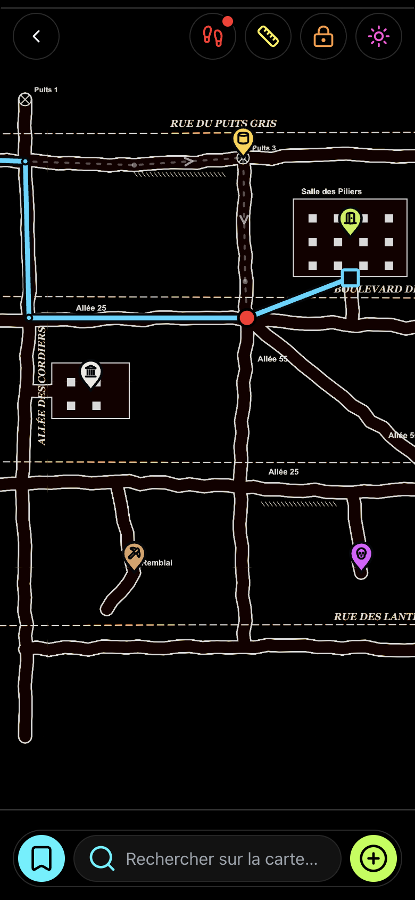
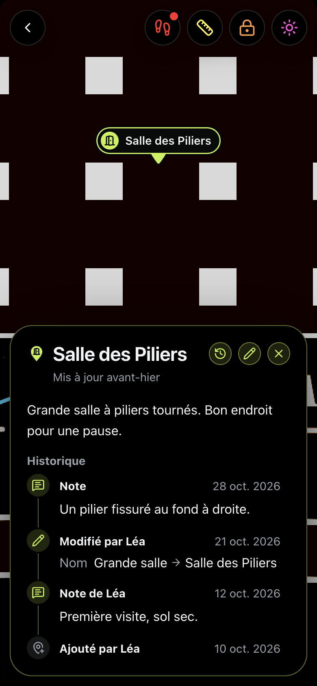
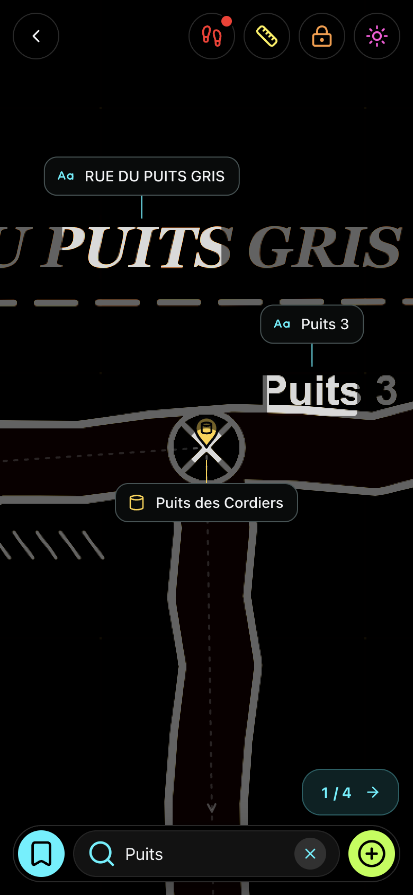

# Mega Maps

Mega Maps est une visionneuse de cartes hors ligne pour téléphone, conçue pour l’exploration des carrières et des cavités artificielles à partir de grands plans scannés.

Une carte est importée une seule fois et reste ensuite sur l’appareil. Les images jusqu’à 600 mégapixels s’affichent et se zooment sans connexion. L’app permet d’y placer des lieux et des itinéraires, de garder la trace d’un parcours, de rechercher le texte imprimé sur le plan et de partager ces données dans un seul fichier.

L’app publiée est disponible sur [app.mega-maps.fr](https://app.mega-maps.fr) et s’utilise une fois ajoutée à l’écran d’accueil.

<p align="center">
  
  
  
</p>

<p align="center"><sub>Captures réalisées sur un plan fictif de démonstration.</sub></p>

## Fonctionnalités

- **Grandes cartes.** Les images JPEG, PNG et WebP jusqu’à 600 mégapixels (32 768 px de côté, 256 Mo par fichier) sont découpées en tuiles à l’import. La visionneuse ne garde jamais une carte entière en mémoire.
- **Hors ligne.** Une fois installée, l’app démarre et fonctionne sans connexion. Les cartes ne passent par aucun serveur.
- **Lieux.** 12 types de repères : entrée, puits, passage, salle, danger, inondé, ossuaire, sculpture, graffiti, outils, squat et point d’intérêt. Chaque lieu peut avoir une description, des photos, une hauteur d’eau ou un niveau de danger, et un historique des visites, notes et modifications.
- **Itinéraires.** Un itinéraire tracé sur la carte indique sa longueur et un temps de marche estimé, une fois l’échelle réglée.
- **Parcours.** Des points marqués pendant la marche enregistrent le chemin parcouru. Un appui long sur la carte ouvre une roue : en haut à gauche pour ajouter un lieu, vers le bas pour marquer la position, en haut à droite pour revenir au dernier point.
- **Recherche de texte.** La reconnaissance de texte, faite sur l’appareil, lit les inscriptions du plan. La recherche porte sur ces inscriptions et sur les lieux enregistrés. Deux termes séparés par un point-virgule, comme `Allée 25; Allée 55`, désignent l’endroit où ils se croisent.
- **Mesures.** L’échelle se règle une fois à partir d’une longueur connue, puis les distances se mesurent directement sur la carte.
- **Rotation.** La carte peut tourner librement, rester verrouillée ou suivre la boussole du téléphone, une fois le nord indiqué.
- **Carte sombre.** Un plan sur fond blanc peut s’afficher en sombre, avec une luminosité réglable, pour ménager les yeux et la batterie sous terre.
- **Partage.** Un fichier `.megamap` contient les lieux, itinéraires, photos et textes détectés choisis, avec ou sans l’image de la carte. Chez un destinataire qui possède déjà la carte, les ajouts se fusionnent avec les siens, et chaque élément garde le pseudo de son auteur.
- **Sauvegardes.** Toute la bibliothèque tient dans un fichier `.megabackup`, restaurable sur un autre appareil.
- **Langues.** Français et anglais.

## Vie privée

Mega Maps n’a ni compte ni serveur. Les cartes, lieux, itinéraires, photos et parcours sont enregistrés dans le stockage du navigateur, sur l’appareil. Ils n’en sortent que dans les fichiers de partage ou de sauvegarde créés par l’utilisateur.

L’app installée envoie des statistiques d’utilisation anonymes à [PostHog](https://posthog.com) (serveurs européens) : les fonctionnalités utilisées, le type d’appareil, la version de l’app, les plantages, et le pseudo défini dans les Réglages s’il existe. Elle n’envoie jamais d’images de cartes, de noms de lieux, de notes ni de positions. L’onglet du navigateur et les versions de développement n’envoient rien. Le détail est dans [`src/stats.ts`](src/stats.ts).

## Appareils pris en charge

Safari sur iOS 17 ou plus récent, et Chrome à jour sur Android. Les apps Chrome installées sur ordinateur fonctionnent aussi, mais l’interface est pensée pour le tactile.

Dans un onglet du navigateur, le site affiche seulement la marche à suivre pour installer l’app. Sur iPhone et iPad, Safari et l’app de l’écran d’accueil ont des stockages séparés : des cartes importées dans un onglet y resteraient bloquées.

## Documentation

- [Fonctionnement](docs/fonctionnement.md) : l’import, le stockage, la visionneuse, la recherche de texte, le partage, l’usage hors ligne et les mises à jour.
- [Développement](docs/developpement.md) : installation, commandes, tests, site de dev et déploiement.
- [Choix techniques](docs/choix-techniques.md) : les contraintes qui ont guidé le code, en version courte.

## Démarrage rapide

Node 20.19+ ou 22.12+.

```sh
npm install
npm run dev     # http://localhost:5173
npm test
```

La suite est dans [Développement](docs/developpement.md).

## Technologies

TypeScript et Vite, sans framework d’interface. Les JPEG sont décodés par [libjpeg-turbo](https://libjpeg-turbo.org) compilé en WebAssembly. La reconnaissance de texte utilise les modèles [PaddleOCR](https://github.com/PaddlePaddle/PaddleOCR) dans [ONNX Runtime Web](https://onnxruntime.ai). Les icônes viennent de [Lucide](https://lucide.dev). L’app est servie en fichiers statiques par Cloudflare Workers. Les licences tierces accompagnent les fichiers qu’elles couvrent, dans `public/codecs/` et `assets/ocr/`.

Créé par Nytro.
