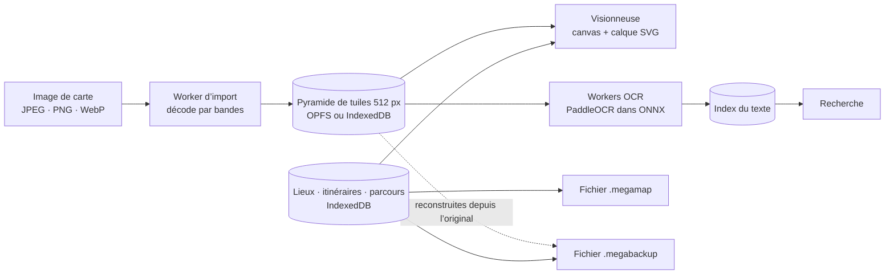

# Fonctionnement de Mega Maps

Mega Maps est une app web statique (une PWA) sans serveur. Tout ce qui suit se passe dans le navigateur, sur l’appareil de l’utilisateur. Les chemins indiquent le code qui s’occupe de chaque partie. Les raisons de ces choix sont résumées dans [Choix techniques](choix-techniques.md).



## Organisation du code

| Dossier | Contenu |
| --- | --- |
| `src/main.ts` | L’écran de la bibliothèque, et le lien entre imports, visionneuse, partage, sauvegardes, mises à jour et détection de texte |
| `src/processing/` | Lecture des en-têtes d’image, décodage JPEG et PNG, découpe en tuiles |
| `src/storage/` | IndexedDB et OPFS, état de chaque carte, photos, sauvegardes, vérifications d’intégrité |
| `src/viewer/` | La caméra, l’affichage des tuiles, les gestes, les lieux et itinéraires sur la carte, les parcours, les mesures, la boussole, la recherche |
| `src/ui/` | Écrans et fenêtres : commandes de la carte, fiches des lieux, Réglages, partage, pages d’installation et de mise à jour |
| `src/ocr/` | Détection et reconnaissance de texte |
| `src/sharing/` | Le format `.megamap`, et la fusion d’un partage dans une carte |
| `src/stats.ts` | Statistiques d’utilisation anonymes |
| `src/locales/fr.ts` | Les textes en français. La phrase anglaise sert de clé : une phrase sans traduction française empêche la compilation. |
| `native/` | Sources C du décodeur JPEG, compilé en WebAssembly dans `public/codecs/` |
| `scripts/` | Étapes de build : service worker, icônes, fichiers OCR, site de dev, sauvegardes de dev |

## Importer une carte

Une image de 9 000 × 9 000 pixels occupe environ 309 Mio une fois décodée, plus qu’un iPhone n’en accorde à une page web. L’app ne décode donc jamais une carte entière. Elle la transforme une fois pour toutes en petites tuiles à l’import, puis ne lit plus que des tuiles.

1. **D’abord les en-têtes.** `src/processing/headers.ts` lit la taille et le format sans rien décoder. L’app refuse les images de plus de 300 mégapixels, de plus de 32 768 px de côté ou de plus de 256 Mo, ainsi que les JPEG qui dépendent d’une rotation EXIF.
2. **Un worker décode par bandes.** `src/processing/import.worker.ts` lit l’image 512 lignes à la fois et découpe chaque bande en tuiles de 512 × 512.
   - Le JPEG est décodé par libjpeg-turbo compilé en WebAssembly (`public/codecs/`, sources dans `native/`), qui lit le fichier via un accès OPFS. Les JPEG progressifs déversent leurs coefficients dans des fichiers temporaires OPFS, pour que la mémoire reste bornée.
   - Le PNG est décompressé par le `DecompressionStream` du navigateur, 4 Kio à la fois, et ses lignes sont défiltrées dans `src/processing/png.ts`.
   - Le WebP et le PNG entrelacé passent par le décodeur du navigateur, avec une taille maximale plus basse.
3. **Une pyramide de niveaux de zoom.** Chaque niveau dézoomé fait la moitié de celui du dessous. Une tuile parente est construite à partir de ses quatre tuiles filles, une à la fois. Toutes les tuiles sont des PNG, pour que les traits fins restent nets en dézoomant (`src/processing/pyramid.ts`).
4. **La carte est prête.** Une carte n’est marquée `ready` qu’une fois toutes ses tuiles écrites. L’image d’origine est gardée pour le partage et les sauvegardes.

Les tuiles vont dans l’Origin Private File System (OPFS) quand le navigateur permet d’y écrire, et dans IndexedDB sinon (`src/storage/payloads.ts`). Un import ou une suppression interrompus laissent une marque que le lancement suivant nettoie, sous un Web Lock, pour que deux fenêtres ne nettoient jamais le travail l’une de l’autre.

L’import demande aussi au navigateur de conserver la bibliothèque quand l’espace manque (`src/storage/protection.ts`). Sans cela, un navigateur peut effacer toute la bibliothèque quand l’appareil est presque plein. Les Réglages indiquent si la bibliothèque est protégée.

## Afficher une carte

La visionneuse (`src/viewer/viewer.ts`) dessine les tuiles sur un canvas 2D, avec une caméra qui garde la position, le zoom et la rotation (`src/viewer/camera.ts`).

- **Seulement ce qui est à l’écran.** Elle choisit le niveau de zoom qui correspond aux pixels de l’écran et charge les tuiles visibles. Pendant leur chargement, elle dessine leurs parentes, si bien que l’écran se remplit d’abord à demi-netteté. Pendant un pincement, elle attend que le zoom soit stable depuis 150 ms avant de charger un niveau plus net.
- **Un budget mémoire fixe.** Les tuiles décodées se partagent 56 Mio, ou 24 Mio sur les appareils qui annoncent moins de 4 Go (`src/viewer/cache.ts`).
- **Carte sombre.** Les cartes claires sont inversées, avec des teintes ramenées à peu près aux couleurs d’origine, et les cartes déjà sombres reçoivent un fond plus noir (`src/viewer/appearance.ts`). L’effet est appliqué une seule fois aux pixels de chaque tuile, dans un worker, au moment de son décodage (`src/viewer/darkener.ts`). Un filtre CSS recolorerait tout l’écran à chaque image, ce qui vidait les batteries sous terre. La luminosité est un simple voile translucide.
- **Des annotations toujours nettes.** Les lieux, itinéraires et le parcours sont dessinés dans un calque SVG au-dessus du canvas, à taille constante à l’écran (`src/viewer/overlays.ts`).
- **Les gestes** (`src/viewer/interactions.ts`) : glisser pour se déplacer ; pincer, ou toucher deux fois puis glisser, pour zoomer ; toucher à deux doigts pour dézoomer ; tourner à deux doigts quand la rotation est libre. Un appui long ouvre une roue (`src/ui/hold-wheel.ts`) : glisser en haut à gauche pour ajouter un lieu, en haut à droite pour revenir au dernier point du parcours, ou vers le bas pour marquer sa position.
- **La rotation** est libre, verrouillée, ou suit la boussole (`src/viewer/compass.ts`). Pour la boussole, l’utilisateur indique une fois où est le nord sur chaque carte. La carte ne tourne qu’une fois un nouveau cap tenu un instant, pour qu’un téléphone qui bouge ne la redessine pas sans cesse.

## Lieux, itinéraires et parcours

Ils sont enregistrés carte par carte dans IndexedDB (`src/storage/navigation.ts`), dans les coordonnées en pixels de l’image d’origine : tourner ou assombrir la carte ne les modifie jamais. Une modification est enregistrée en moins de 250 ms, et la position de la caméra une fois qu’elle est immobile depuis 2 secondes.

- **Les lieux** ont un des 12 types, un nom, une description, des photos, et une hauteur d’eau ou un niveau de danger pour les types qui en ont besoin. Chaque lieu garde un historique des visites, notes et modifications, et chaque modification note ce qui a changé (par exemple « Genou → Cheville »). Les photos sont stockées à part (`src/storage/photos.ts`).
- **Les itinéraires** sont des lignes de points avec un nom, une description et des photos.
- **Les parcours** sont les points que l’utilisateur marque en marchant, chacun avec son heure. Le dernier point pulse tant qu’il est récent et s’estompe au bout d’une heure, car une position ancienne n’est plus qu’une supposition. Les parcours terminés restent dans les parcours passés. Ils ne quittent jamais l’appareil, sauf dans une sauvegarde.
- **Échelle et mesures.** L’utilisateur touche les deux bouts d’une longueur connue, comme l’échelle graphique du plan, puis saisit cette longueur. Dès lors, les itinéraires et les mesures affichent des distances, et des temps de marche à la vitesse choisie dans les Réglages (`src/viewer/measure.ts`).

Plusieurs fenêtres peuvent ouvrir la même bibliothèque. Elles se préviennent des changements par un `BroadcastChannel`, et chaque écriture vérifie, dans la même transaction, que la carte existe toujours : un enregistrement tardif ne peut pas faire revenir une carte supprimée.

## Recherche de texte (OCR)

Après l’import d’une carte, l’app propose de lire le texte imprimé dessus, entièrement sur l’appareil (`src/ocr/`). Aucune lecture ne démarre sans un oui : la détection peut aussi être lancée plus tard depuis les paramètres avancés de la carte.

1. **La détection** repère les zones de texte avec le modèle PaddleOCR `PP-OCRv5_mobile_det`. Elle travaille à la pleine résolution de la carte, par sections de 1 024 px qui se chevauchent, car réduire la carte d’abord ferait disparaître les petits caractères. Chaque inscription appartient à la seule section qui contient son centre, pour n’être lue qu’une fois.
2. **L’orientation.** Un petit classifieur indique si chaque ligne est à l’envers. Quand il hésite, la ligne est lue dans les deux sens et la lecture la plus sûre l’emporte. Les inscriptions sont lues quel que soit leur angle.
3. **La reconnaissance** lit chaque ligne avec le modèle latin `PP-OCRv5`.

Les modèles tournent dans le backend WebAssembly d’ONNX Runtime Web, dans un à trois workers selon la mémoire de l’appareil. Les modèles et le moteur sont livrés avec l’app, donc la détection de texte marche hors ligne. Le résultat est enregistré dans un index de texte par carte (`src/storage/ocr.ts`). L’index porte une version : à l’ouverture d’une carte lue par une ancienne version de la détection, l’app propose de la relire. L’ancien index sert à la recherche en attendant.

La recherche (`src/viewer/map-search.ts`) regarde dans les lieux enregistrés et dans l’index de texte, sans tenir compte des accents ni des majuscules. Deux termes séparés par un point-virgule, comme `Allée 25; Allée 55`, trouvent les endroits où les deux apparaissent côte à côte, comme un carrefour.

## Partage (`.megamap`)

Un partage est un seul fichier binaire (`src/sharing/format.ts`) :

```
"MEGAMAP1" | taille du manifeste (uint32 LE) | manifeste JSON | photos | index de texte | image de la carte (facultative)
```

Les images et photos sont stockées telles quelles, jamais encodées en base64 ni recompressées.

- L’expéditeur choisit les lieux et itinéraires, et s’il joint l’image de la carte. Un partage avec l’image contient aussi l’index de texte, pour que le destinataire n’ait pas à relire la carte. La feuille de partage du téléphone envoie le fichier, ou l’app l’enregistre quand le partage de fichiers n’est pas disponible.
- **Retrouver la carte.** L’app du destinataire retrouve la même carte grâce à l’empreinte SHA-256 des octets de l’image d’origine et à ses dimensions, jamais grâce au nom du fichier. Si le destinataire n’a pas cette carte et que le partage ne contient pas l’image, il choisit sa copie de l’original, et l’app vérifie que c’est exactement le même fichier.
- **Fusionner ou remplacer.** Fusionner ajoute les nouveaux lieux et itinéraires, et les nouvelles entrées d’historique aux lieux déjà présents. Cela ne fait jamais revenir ce que le destinataire a supprimé. Remplacer met les lieux et itinéraires partagés à la place de ceux de la carte.
- **Auteurs.** Chaque lieu, itinéraire et entrée d’historique peut porter `by`, le pseudo de qui l’a créé. L’envoi remplit le pseudo de l’expéditeur là où il manque, si bien que les éléments venus d’autres personnes gardent leur auteur.
- **Jamais partagés :** les parcours, l’échelle de la carte, les réglages d’affichage et la position de la caméra.
- Un fichier partagé n’est pas fiable par défaut. Le lecteur valide chaque champ et impose des limites de nombre et de taille avant d’utiliser quoi que ce soit.

Toutes les anciennes versions du format restent lisibles. Une ancienne app qui reçoit une version plus récente demande à être mise à jour.

## Sauvegardes (`.megabackup`)

Une sauvegarde contient l’image d’origine de chaque carte, ses lieux, itinéraires, parcours, photos et index de texte, ainsi que le pseudo (`src/storage/backup.ts`). Elle ne contient pas les tuiles : la restauration les reconstruit depuis les originaux, ce qui prend du temps mais garde un fichier bien plus petit. Les cartes restaurées gardent leur identité, donc restaurer deux fois la même sauvegarde n’ajoute rien.

Les Réglages indiquent la date de la dernière sauvegarde et rappellent de la garder ailleurs, par exemple dans Fichiers ou sur un autre appareil.

## Hors ligne et mises à jour

Après chaque build, `scripts/build-sw.mjs` écrit le service worker, avec l’empreinte et la taille de chaque fichier de l’app.

- **L’installation** télécharge tous les fichiers avant d’en enregistrer un seul, pour qu’une version à moitié téléchargée ne se lance jamais.
- **Les cartes ne viennent jamais du réseau.** Le service worker ne sert que les fichiers de l’app.
- **Les mises à jour.** L’app demande à `/app-version.json` si une version plus récente est en ligne. Elle l’installe d’elle-même ou demande d’abord, selon les Réglages. Un fichier déjà présent sur l’appareil est copié au lieu d’être téléchargé quand ses octets correspondent à l’empreinte de la nouvelle version. Les modèles OCR et leur moteur font 27 des 28 Mo de l’app et changent rarement, donc la plupart des mises à jour téléchargent très peu.
- Une fenêtre ouverte avant une mise à jour continue de fonctionner. Les fichiers renommés de la version précédente restent jusqu’à la mise à jour suivante, pour que cette fenêtre puisse encore lancer ses workers hors ligne.

**L’app ne fonctionne qu’une fois installée.** Sur iPhone et iPad, Safari et l’app de l’écran d’accueil ont des stockages séparés : des cartes importées dans un onglet y resteraient bloquées. Dans un onglet du navigateur, le site publié n’affiche donc que la page d’installation (`src/ui/install-page.ts`), qui guide l’ajout de l’app à l’écran d’accueil. Le serveur de dev s’en passe.

## Statistiques d’utilisation

`src/stats.ts` envoie des évènements anonymes aux serveurs européens de PostHog, et uniquement depuis l’app installée : jamais depuis un onglet, les tests ou le site de dev. Les évènements décrivent l’usage des fonctionnalités et des nombres, comme les mégapixels d’une carte ou le nombre de résultats d’une recherche. Ils ne contiennent jamais d’images de cartes, de noms, de notes, de texte ni de positions. Chaque évènement porte la version de l’app, le type d’appareil, l’état de la connexion, et le pseudo des Réglages s’il y en a un. Les plantages sont signalés avec leur message et une courte pile d’appels.

Les évènements attendent sur l’appareil tant qu’il est hors ligne (500 au plus) et partent par lots dès qu’il y a une connexion.

## Langues

Le français est la langue par défaut, l’anglais l’autre choix. La phrase anglaise sert de clé de traduction (`src/i18n.ts`), et TypeScript fait échouer le build si `src/locales/fr.ts` n’en a pas la traduction. Changer de langue relance l’app.
